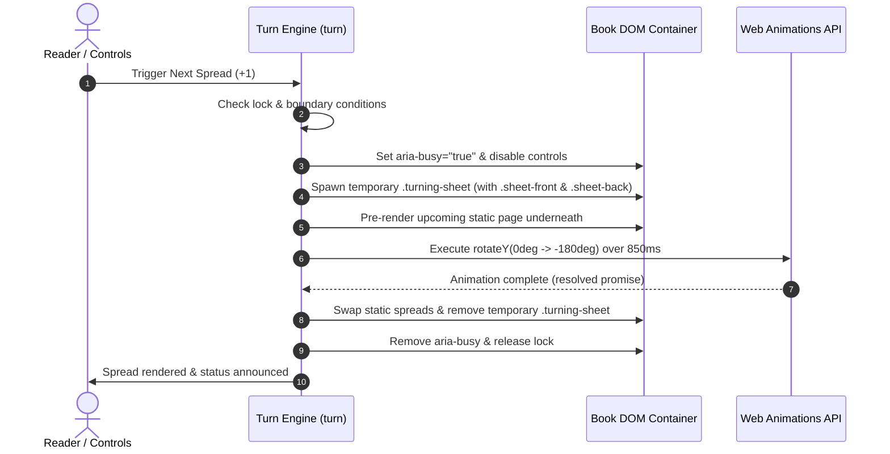

# 📖 3D Portfolio Book

<p align="center">
  
  
  
  
  
  
</p>

<p align="center">
  <b>A tactile, editorial 3D digital book experience with realistic page-turning physics and an integrated personal portfolio builder.</b>
</p>

<p align="center">
  <a href="#-key-features">Key Features</a> •
  <a href="#-quick-start">Quick Start</a> •
  <a href="#-interactive-controls">Controls</a> •
  <a href="#-architecture--physics">Architecture & Physics</a> •
  <a href="#-in-browser-book-builder">Book Builder</a> •
  <a href="#-project-structure">Project Structure</a> •
  <a href="#-deployment">Deployment</a>
</p>

---

## 🌟 Overview

The **3D Portfolio Book** reimagines personal portfolios and digital publications as a tangible, physical volume. Instead of standard endless vertical scrolling, it treats content as curated double-page spreads bound together in an interactive volume.

Built entirely with **Vanilla JavaScript (ES6+)** and hardware-accelerated **CSS 3D Transforms**, it features:
- Realistic 3D rotational sheet physics with dynamic dual-sided rendering.
- Ambient paper gradients, spine creasing, depth shadows, and editorial serif typography.
- Multi-modal interaction: hardware keyboard navigation, touch swipes, mouse edge clicks, and button controls.
- Complete accessibility fallbacks (`prefers-reduced-motion`, ARIA live region announcements, keyboard focus traps).
- **In-Browser Portfolio Studio & Exporter**: Paste raw notes to auto-generate custom spreads, tweak paper/ink palettes and typography, save locally, and download a completely standalone, single-file HTML portfolio ready to deploy anywhere.

---

## ✨ Key Features

| Feature | Description |
| :--- | :--- |
| **Physics-Based Page Turning** | Dual-faced moving sheet (`rotateY: 0deg → ±180deg`) using the **Web Animations API** with smooth cubic-bezier easing (`.35, .05, .2, 1`). |
| **Tactile Editorial Aesthetics** | Warm cream paper textures (`#f1eee3`), spine shadow gradients, typography inspired by luxury publications (`Playfair Display` & `DM Sans`). |
| **Multi-Modal Navigation** | Navigate via keyboard arrows (`←` / `→`), edge clicks (<25% or >75% width), mobile touch swipes, or navigation buttons. |
| **Zero Runtime Dependencies** | No heavy 3D rendering engines (Three.js/Babylon.js) or bloated libraries required. Ultra-lightweight and lightning fast. |
| **Interactive Book Builder** | Live GUI to write, edit, reorder, add, or delete pages, customize paper/ink palettes, and select font headings. |
| **Smart Markdown-Like Parser** | Paste raw notes; auto-splits into structured sections (`About`, `Experience`, `Education`, `Skills`, `Projects`, `Contact`). |
| **Single-File HTML Exporter** | Bundles custom content, styles, and flip engine into an offline-ready, standalone `.html` file with a single click. |
| **Local State Persistence** | Saves custom configurations directly to browser `localStorage` (`portfolio-book-v1`) for uninterrupted editing sessions. |
| **Accessible & Inclusive** | Full WCAG compliance, keyboard focus rings (`:focus-visible`), `aria-busy` state locks, and instant flips for `prefers-reduced-motion`. |

---

## 🕹️ Interactive Controls

Readers can interact with the book through any of the following input methods:

```
                  ┌───────────────────────────────────────────────┐
                  │                 PORTFOLIO BOOK                │
                  │                                               │
   [CLICK <25%]   │   ◄─── Previous Page      Next Page ───►      │   [CLICK >75%]
   [SWIPE RIGHT]  │   [Arrow Left ←]          [Arrow Right →]     │   [SWIPE LEFT]
                  │                                               │
                  └───────────────────────┬───────────────────────┘
                                          │
                     [BUTTON: ←]  SPREAD 01 / 04  [BUTTON: →]
```

- **Keyboard**: Focus the book and press <kbd>←</kbd> (Left Arrow) or <kbd>→</kbd> (Right Arrow).
- **Mouse / Trackpad**: Click within the outer 25% of either page edge to turn towards that direction.
- **Touch / Mobile**: Horizontal swipe gestures (triggered when swipe delta exceeds 50px horizontally).
- **GUI Controls**: Click the minimal Previous (`←`) or Next (`→`) buttons below the spine.

---

## 🚀 Quick Start

### Option 1: Local Development with Vite (Recommended)

Requires [Node.js](https://nodejs.org/) (v18 or higher):

```bash
# 1. Clone or navigate into the repository
cd 3D-Book

# 2. Install dependencies (Vite dev server)
npm install

# 3. Start local development server
npm run dev
```

Your browser will automatically open [http://localhost:5173](http://localhost:5173) with instant Hot Module Replacement (HMR).

### Option 2: Run Directly Without Node.js

Because the core application is built with pure Vanilla web standards, you can also run it directly:

```bash
# Simply double-click index.html or open via Python static server:
python -m http.server 3000
```
> **Note:** The "Download standalone website" feature in the builder requires HTTP/HTTPS serving (Vite or static server) to read `style.css` and `javaScript.js` via `fetch()`.

---

## 🛠️ Architecture & Physics

### 1. 3D Page Flip Mechanics

The flipbook is constructed inside a CSS 3D perspective context (`perspective: 1800px; transform-style: preserve-3d;`).



#### Dual-Sided Moving Sheet:
1. When a turn is initiated, a lightweight dynamic DOM sheet (`.turning-sheet`) is mounted with two physical faces:
   - **`sheet-front`**: Displays the departing page (`rotateY: 0deg`).
   - **`sheet-back`**: Displays the incoming opposite page (`rotateY: 180deg`).
2. Both faces employ `backface-visibility: hidden` and are shaded with lighting gradients that simulate real paper curvature highlights.
3. The underlying static pages immediately render the target spread beneath the turning sheet.
4. The Web Animations API rotates the sheet 180° around its spine edge (`transform-origin: left center` for forward, `transform-origin: right center` for backward).
5. Once settled, the temporary sheet is cleaned up, preserving memory and preventing DOM bloat.

### 2. State & Motion Safety

```javascript
// Graceful fallback for users requesting reduced motion
if (!matchMedia('(prefers-reduced-motion: reduce)').matches) {
  const animation = sheet.animate([
    { transform: 'rotateY(0deg)' },
    { transform: `rotateY(${direction > 0 ? -180 : 180}deg)` }
  ], { duration: 850, easing: 'cubic-bezier(.35,.05,.2,1)', fill: 'forwards' });
  await animation.finished;
}
```

---

## 🎨 In-Browser Book Builder

Below the book viewport is an integrated **Studio & Generator** (`builder.js`). It allows any developer or designer to customize the book and generate a custom portfolio in seconds:

```
┌─────────────────────────────────────────────────────────────────┐
│                      YOUR OWN EDITION BUILDER                   │
├───────────────────────────────┬─────────────────────────────────┤
│ Author Information            │ Page Manager                    │
│ • Name: [ M Mobeen          ] │ ┌─────────────────────────────┐ │
│ • Role: [ Web Developer...  ] │ │ Page 1: About   [↑] [↓] [x] │ │
│                               │ │ Page 2: Skills  [↑] [↓] [x] │ │
│ Markdown / Plain Text Parser  │ │ Page 3: Works   [↑] [↓] [x] │ │
│ [Paste your raw resume...]    │ └─────────────────────────────┘ │
│ [Organise into sections]      │ [+ Add a page]                  │
│                               │                                 │
│ Aesthetic Styling             │ Actions                         │
│ • Paper Color: [ #f1eee3 ]    │ [Create book]  [Save in browser]│
│ • Ink Color:   [ #243239 ]    │ [Load saved]   [Download site]  │
│ • Typography:  [Classic serif]│                                 │
└───────────────────────────────┴─────────────────────────────────┘
```

### Key Builder Capabilities:
1. **Intelligent Text Organiser**:
   Paste bullet points or raw notes containing headings like `About:`, `Experience:`, `Education:`, `Skills:`, `Projects:`, or `Contact:`. The parser automatically chunks your text into discrete pages.
2. **Page Reordering & Editing**:
   Move sections up or down, edit headings, refine body copy, or append new custom spreads.
3. **Odd/Even Balancing**:
   The engine automatically balances odd page counts by creating an elegant "Thank You" concluding spread, ensuring dual-page symmetry.
4. **Standalone Exporter**:
   Generates a standalone `my-portfolio.html` file that inlines the compiled styles, sanitized JSON data, and minimal runtime. It requires zero server setup and can be emailed, hosted on GitHub Pages, or sent to clients.

---

## 📁 Project Structure

```
3D-Book/
├── index.html          # Main HTML5 entry point & portfolio shell
├── style.css           # 3D transforms, typography, responsive & dark theme styles
├── javaScript.js       # Core 3D flipbook engine, touch gestures & default spreads
├── builder.js          # Interactive book studio, parser, storage & HTML bundler
├── package.json        # NPM project scripts & Vite dependencies
├── package-lock.json   # Deterministic lockfile
├── .gitignore          # Excludes node_modules and build artifacts
├── source/             # Project assets & imagery
│   └── IMG_2024.jpg    # Sample high-resolution portfolio asset
└── README.md           # Comprehensive project documentation
```

---

## ⚙️ Configuration & Theming

The book's visual theme is driven by CSS custom properties in [style.css](file:///d:/WorkStation/3D-Book/style.css). You can override them globally or per-edition:

```css
:root {
  --ink: #243239;          /* Deep slate ink color for typography */
  --muted: #667478;        /* Subdued secondary labels and timestamps */
  --paper: #f1eee3;        /* Warm tactile book paper */
  --paper2: #e8e6d9;       /* Inner fold gradient for spine shadow */
  --accent: #c5e36b;       /* Button hover & brand highlight */
  --orange: #d48058;       /* Warm editorial accent & focus ring */
  --line: #bfc8c3;         /* Editorial divider rules */
  --bg: #dce4dd;           /* Background studio wall color */
  --book-heading: 'Playfair Display', Georgia, serif;
}
```

---

## 📦 Available Scripts

All scripts can be executed via `npm`:

| Command | Description |
| :--- | :--- |
| `npm run dev` | Starts Vite local development server with instant Hot Module Reloading (HMR). |
| `npm run build` | Compiles and optimizes assets into the `dist/` directory for production. |
| `npm run preview` | Locally previews the production build from `dist/`. |

---

## 🌐 Production Deployment

Since the output is entirely static, it can be deployed to any static host:

### 1. GitHub Pages
1. Push this repository to GitHub.
2. Go to **Settings > Pages**.
3. Under **Build and deployment**, set Source to **GitHub Actions** (or select the `main` branch root folder).
4. For Vite builds, use the standard [Vite GitHub Pages Action](https://vitejs.dev/guide/static-deploy.html#github-pages).

### 2. Vercel
```bash
npx vercel
```
*Framework Preset: Vite | Root Directory: `./`*

### 3. Netlify
```bash
npx netlify deploy --prod
```
*Build command: `npm run build` | Publish directory: `dist`*

### 4. Cloudflare Pages
1. Connect repository in Cloudflare Dashboard.
2. Build command: `npm run build`
3. Output directory: `dist`

---

## ♿ Accessibility & Performance

- **Keyboard First**: Complete keyboard navigability with focus outline (`outline: 3px solid #d48058`).
- **Screen Reader Announcements**: An invisible `aria-live="polite"` region broadcasts page changes (e.g., `"SPREAD 02 / 04"`).
- **Reduced Motion Support**: Automatically queries `(prefers-reduced-motion: reduce)` to disable 3D rotation animations and immediately snap to the selected spread.
- **Inert Moving Sheets**: While turning, active sheets have `inert` and `aria-hidden="true"` applied to prevent accidental focus traversal or misaligned screen reader readings.
- **Ultra Lightweight**: Zero heavy 3D frameworks means fast first contentful paint (FCP) and 60fps animations even on mobile devices.

---

## 🤝 Contributing

Contributions, feedback, and ideas are welcome!
1. Fork the Project.
2. Create your Feature Branch (`git checkout -b feature/AmazingFeature`).
3. Commit your Changes (`git commit -m 'Add some AmazingFeature'`).
4. Push to the Branch (`git push origin feature/AmazingFeature`).
5. Open a Pull Request.

---

## 📄 License

Distributed under the **MIT License**. See `LICENSE` for more information.

---

<p align="center">
  Crafted with care by <b>M Mobeen</b> ✳ Inspired by timeless editorial design.
</p>
